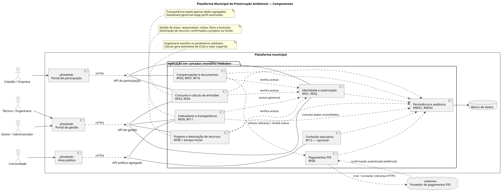
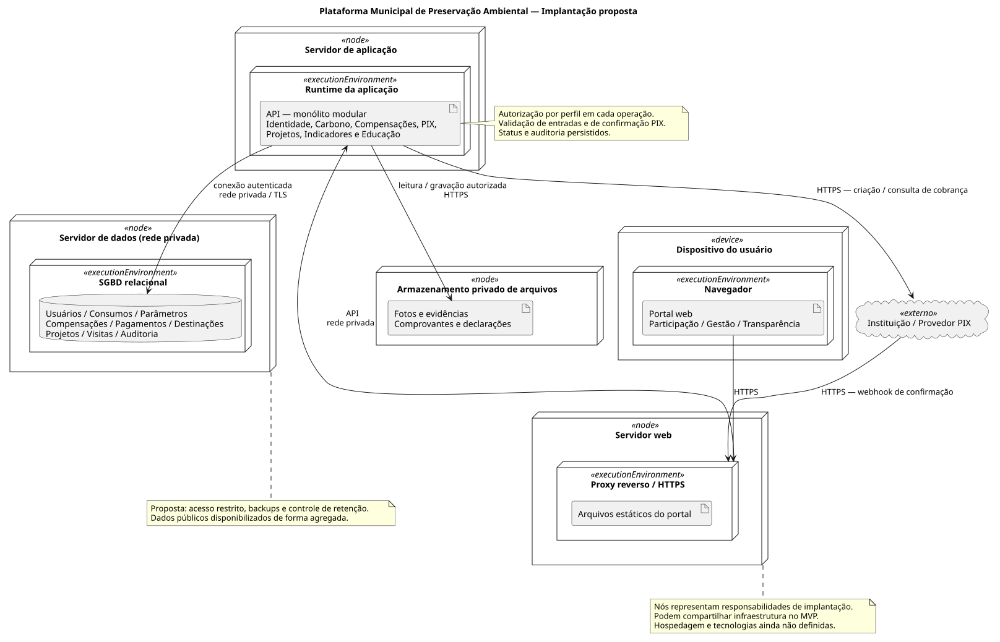
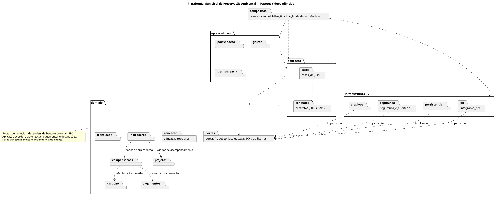

# Plataforma para o Programa Sistêmico Municipal de Preservação Ambiental

Documentação de arquitetura proposta a partir do **Main Project, versão 0.4, de 10/09/2026**, para Santa Cruz do Sul. O material da Aula 10 apresenta diagramas de componentes, implantação e pacotes e a entrega de documento de arquitetura com diagramas UML.

## Diagramas

Os fontes editáveis são PlantUML. As imagens abaixo foram geradas a partir desses fontes e estão disponíveis em SVG e PNG.

### Componentes

[Fonte PlantUML](diagramas/componentes.puml) · [PNG](diagramas/componentes.png)

### Implantação

[Fonte PlantUML](diagramas/implantacao.puml) · [PNG](diagramas/implantacao.png)

### Pacotes

[Fonte PlantUML](diagramas/pacotes.puml) · [PNG](diagramas/pacotes.png)

## Decisão arquitetural (ADR-001)

**Status:** proposta para o MVP; o documento de visão não define uma arquitetura ou tecnologias.

**Contexto:** integrar cadastro, cálculo, compensação voluntária, PIX, destinação de recursos e acompanhamento ambiental, preservando rastreabilidade e dados pessoais. O escopo prevê evolução gradual.

**Decisão:** monólito modular com camadas de apresentação, aplicação, domínio e infraestrutura. Os módulos têm responsabilidades separadas, mas são inicialmente implantados como uma aplicação. A integração PIX fica isolada em um adaptador externo. As regras de negócio dependem de portas, implementadas pela infraestrutura.

**Justificativa:** simplifica operação e consistência dos registros no MVP, mantendo separação suficiente para evolução. Não há no documento evidência de necessidade de implantar cada módulo como serviço independente.

**Consequências:** os módulos compartilham implantação e banco; alterações exigem coordenação. Limites de pacotes e autorização precisam ser respeitados. Consultas consolidadas devem preservar o desempenho conforme o volume cresce (RNF04).

## Fluxo principal

1. Cidadão ou empresa se cadastra, autentica e registra tipo e volume de combustível.
2. A aplicação valida os dados e calcula CO2 equivalente e valor sugerido com parâmetros mantidos pela Engenharia.
3. O participante confirma a intenção de compensação e recebe QR Code / PIX Copia e Cola.
4. Após confirmação do provedor, a aplicação registra o pagamento, atualiza o status e disponibiliza comprovante no histórico.
5. O gestor vincula recursos confirmados a projetos ou ao fundo ambiental. Técnicos registram visitas, fotos e evolução das áreas.
6. Gestores consultam indicadores; a comunidade consulta resultados agregados.

O pagamento pode expirar após 15 minutos, conforme US-02, permitindo nova cobrança. Indisponibilidade do provedor interrompe a geração e informa tentativa posterior. Uma estimativa de carbono é pré-condição da compensação, conforme UC-02.

## Rastreabilidade

| Requisitos | Responsabilidade |
| --- | --- |
| RF01–RF02 | Identidade e autorização por perfil |
| RF03–RF04 | Registro de consumo, estimativa e manutenção de parâmetros pela Engenharia |
| RF05, RF07, RF10 | Compensação, histórico, comprovante e declaração anual |
| RF06 | Integração com pagamento PIX |
| RF08 | Destinação de recursos a projetos ou fundo |
| RF09, RF11 | Dashboard gerencial e transparência pública agregada |
| RF12 | Conteúdo educativo, opcional no MVP (Could Have) |
| Escopo inicial | Gestão de projetos, áreas, responsáveis, visitas, fotos e evolução |
| RNF01–RNF02 | Proteção de dados, autorização, logs e rastreabilidade |
| RNF03–RNF05 | Interface simples, crescimento gradual e publicação agregada |

## Premissas de modelagem

- Engenharia é representada pelo perfil técnico; gestor e administrador aparecem agrupados visualmente, mas mantêm permissões distintas (RF02).
- Proprietários, produtores, conselho e instituições de pesquisa são stakeholders; o documento não especifica operações próprias suficientes para criar módulos ou portais exclusivos para eles.
- Não foi modelada integração com Receita Estadual ou postos: RF03 prevê informação pelo usuário e a integração obrigatória com postos está fora do escopo inicial.
- Webhook autenticado, proxy HTTPS, SGBD relacional, armazenamento privado e backups são propostas técnicas; não são tecnologias ou infraestrutura já contratadas.
- Comunicações com usuários constam da visão geral, mas não têm RF específico: nesta proposta são avisos na interface; canais externos dependem de detalhamento posterior.
- Declarações são documentos de compensação voluntária, não certificação de créditos de carbono regulados.
- O portal público usa consultas agregadas e não permite acessar dados pessoais ou arquivos privados.

## Editar e renderizar

Abra um arquivo `.puml` no [PlantUML Web Server](https://www.plantuml.com/plantuml/uml/) e cole o conteúdo. Também é possível renderizar os três arquivos com uma instalação local do PlantUML.

O link de PlantUML fornecido inicialmente contém apenas o exemplo `Bob -> Alice : hello`; ele foi usado como ferramenta, não como modelo do projeto.
